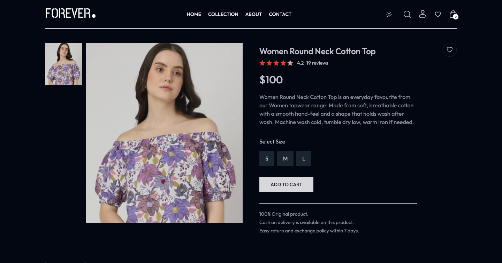
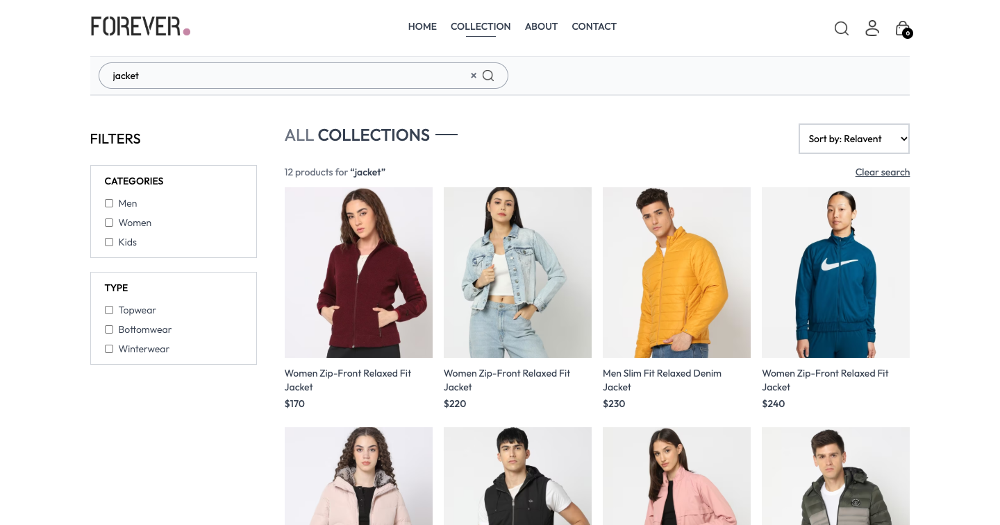
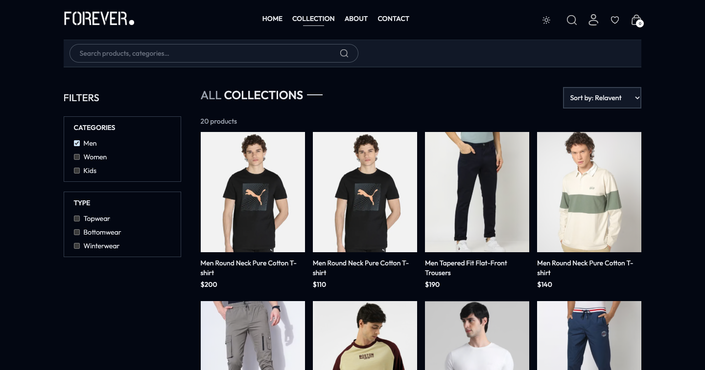
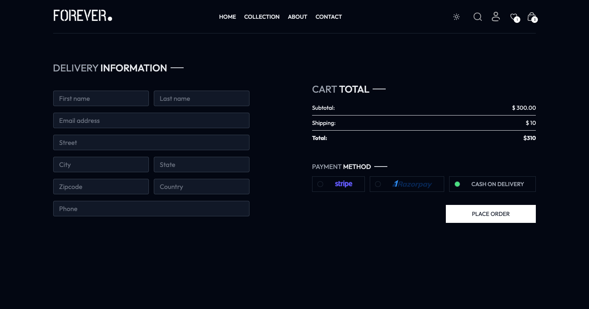
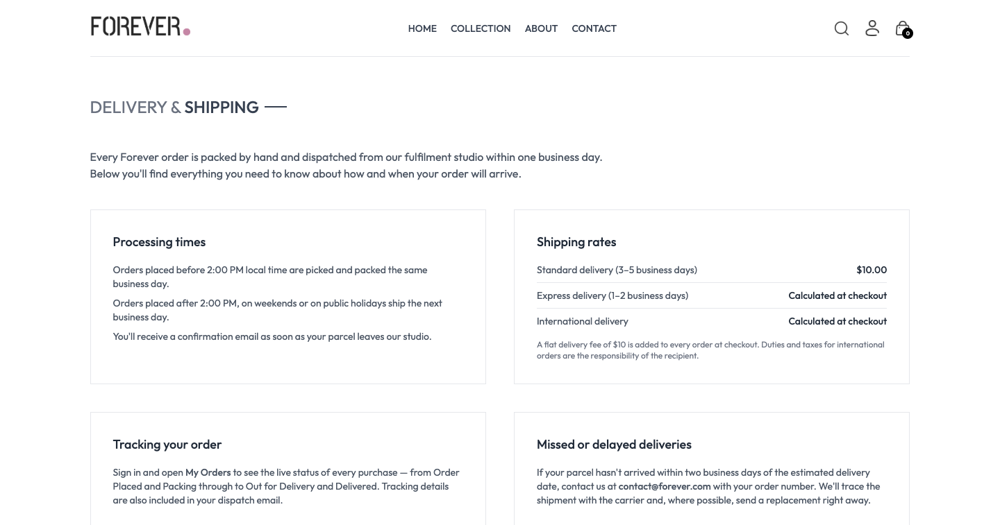
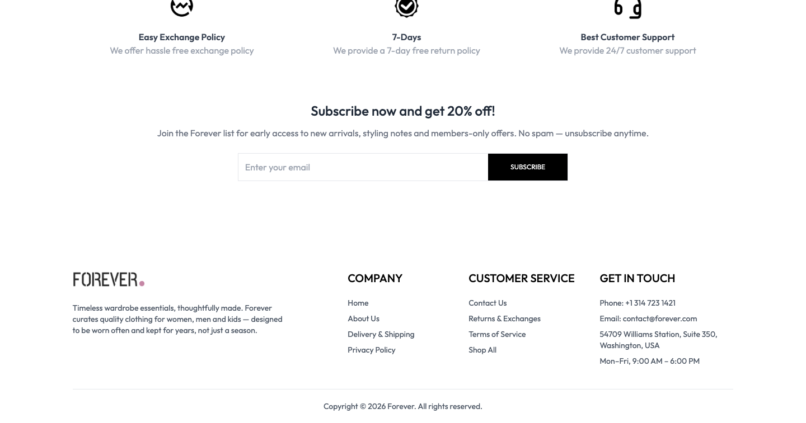
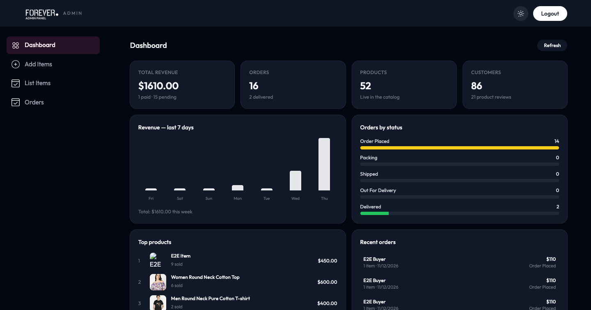

# Forever — Full-Stack E-Commerce Store

A complete e-commerce application built with a MERN stack — a customer storefront, an admin panel with analytics, a REST API, and a React Native (Expo) mobile app that shares the same backend. Supports user accounts, social sign-in, persistent carts, wishlists, product reviews, order tracking, and three payment options — **Cash on Delivery, Stripe, and Razorpay**.

















## Features

**Storefront**
- Product catalog with category/sub-category filters and price sorting
- Full search across name, category, sub-category and description — from the header search icon or the collection search bar, with result counts, empty state and one-click clear
- Product detail pages with size selection, image gallery, related products and real fit/care info
- Product reviews and ratings: average score, star breakdown bars, review list and a one-review-per-customer form
- Wishlist with a heart button on product pages, a header count badge and a dedicated wishlist page
- Persistent server-side cart (per user), quantity editing and order totals
- User registration / sign-in, Google sign-in (real OAuth or a clearly labelled demo fallback)
- Password reset by email (one-hour, single-use hashed token) and a newsletter signup wired to the API
- Order history with a live tracking timeline (Placed → Packing → Shipped → Out for Delivery → Delivered)
- Checkout with delivery details and payment method selection (COD / Stripe / Razorpay)
- Content pages for every footer link: About, Delivery & Shipping, Returns & Exchanges, Privacy Policy, Terms of Service, Contact
- Light / dark theme toggle in the header (follows the OS preference on first visit, then remembers your choice)
- Accessible by default: skip link, main landmark, visible keyboard focus, labelled controls and reduced-motion support
- SEO: per-product titles/descriptions, Product JSON-LD, Open Graph/Twitter tags, sitemap.xml and robots.txt generated at build
- Friendly 404 page for unknown routes

**Admin panel**
- Admin sign-in
- Light / dark theme toggle (follows the OS preference on first visit, then remembers your choice)
- Analytics dashboard: revenue, orders, products, customers, 7-day revenue chart, orders by status, top products and recent orders
- Add products with image uploads (Cloudinary), list & remove products
- View all orders and update order status (Placed → Packing → Shipped → Out for Delivery → Delivered)

**Mobile app (React Native / Expo)**
- Home, shop with search and category chips, product detail with reviews, cart, checkout, orders with tracking, wishlist and profile
- Shares the same API, accounts, cart, wishlist and orders as the web storefront
- Runs in Expo Go on iOS/Android or in the browser via `expo start --web`

**Backend API**
- JWT auth for users and a separate admin token flow (role-scoped, 12-hour expiry)
- Google ID-token verification via `google-auth-library`, plus a demo social-login endpoint that is development-only
- Password reset tokens (SHA-256 hashed, one-hour expiry) with Resend email delivery when configured
- Newsletter subscriptions
- Reviews, wishlist and admin analytics endpoints
- Order placement and payment verification (Stripe sessions, Razorpay orders)
- Signed Stripe/Razorpay webhooks so orders are fulfilled even if the shopper closes the tab
- Hardened for serverless: cached MongoDB connection, lazy payment clients, Helmet security headers, rate limiting and a strict CORS allowlist
- MongoDB via Mongoose; image hosting on Cloudinary

## Tech stack

| Layer | Technologies |
| --- | --- |
| Storefront | React 18 (Vite), Tailwind CSS, React Router, Axios, React Toastify |
| Admin panel | React 18 (Vite), Tailwind CSS, React Router, Axios |
| Mobile | React Native 0.88 + Expo 58, React Navigation 7, AsyncStorage |
| API | Node.js, Express 4, Mongoose, JWT, Bcrypt, Multer, Cloudinary, Google Auth Library, Stripe, Razorpay, PayPal SDK |
| Database | MongoDB |
| Tests | Selenium WebDriver + Mocha (E2E), Node `fetch` (API tests) |

## Quick start

**Prerequisites:** Node.js 20+, MongoDB running locally (`mongod`), and a Cloudinary account (for product-image uploads — not needed for the seed's offline mode).

```bash
# 1. Install dependencies (one command per app)
cd backend && npm install && cd ..
cd frontend && npm install && cd ..
cd admin && npm install && cd ..
cd mobile && npm install && cd ..
cd e2e && npm install && cd ..

# 2. Configure environment (copy each example and fill in your values)
cp backend/.env.example backend/.env
cp frontend/.env.example frontend/.env
cp admin/.env.example admin/.env
cp mobile/.env.example mobile/.env

# 3. Seed the database (52-product catalog, demo user and demo orders)
cd backend && npm run seed && cd ..

# 4. Start everything (foreground: Ctrl+C stops all)
./start-all.sh

# …or run in the background as launchd services (auto-restart, stays up)
./scripts/services.sh start
./scripts/services.sh status
./scripts/services.sh logs
./scripts/services.sh stop
```

| Service | URL |
| --- | --- |
| Storefront | http://localhost:5178 |
| Admin panel | http://localhost:5179 |
| API | http://localhost:4001 |
| Mobile (Expo web) | http://localhost:8083 (after `cd mobile && npx expo start --web`) |

> **Ports:** the API uses **4001** (Vite dev servers use 5178/5179, pinned in each `vite.config.js`). If those ports are taken, Vite fails fast (`strictPort`) — pick another free triplet and update the three `.env` files.

## Demo accounts (after seeding)

| Role | Email | Password |
| --- | --- | --- |
| Admin | `admin@admin.com` | `admin` (from `backend/.env`) |
| Demo shopper | `demo@forever.test` | `demo1234` |

> Change the admin credentials in `backend/.env` before deploying anywhere real.

### Social sign-in

The storefront has two Google paths:

- **Real OAuth** — set `GOOGLE_CLIENT_ID` in `backend/.env` and `VITE_GOOGLE_CLIENT_ID` in `frontend/.env`, and add `http://localhost:5178` as an authorised JavaScript origin for that Google OAuth client. The frontend renders the official Google button and the backend verifies the ID token with `google-auth-library`.
- **Demo fallback** — with no client ID configured, the login page shows a clearly labelled **“Continue with Google (demo)”** button that signs into a shared demo social account so reviewers can see the flow. It is only rendered when the storefront runs in development (`import.meta.env.DEV`), and the API endpoint refuses to run when `NODE_ENV=production`, so it can never be used on a deployed site.

## Storefront pages

| Page | Route | Reachable from |
| --- | --- | --- |
| Home | `/` | logo / nav / footer |
| Collection (with search + filters) | `/collection` | nav / footer “Shop All” |
| Product detail | `/product/:id` | any product card |
| Cart | `/cart` | nav cart icon |
| Checkout | `/place-order` | cart |
| My Orders | `/orders` | profile menu |
| Login / Sign up | `/login` | profile icon |
| Forgot password | `/forgot-password` | login page |
| Reset password | `/reset-password?token=…` | email link |
| Wishlist | `/wishlist` | header heart / profile menu |
| 404 | any unknown route | — |
| About | `/about` | nav / footer |
| Contact | `/contact` | nav / footer |
| Delivery & Shipping | `/delivery` | footer |
| Returns & Exchanges | `/returns` | footer |
| Privacy Policy | `/privacy` | footer |
| Terms of Service | `/terms` | footer |

## Admin pages

| Page | Route |
| --- | --- |
| Analytics dashboard | `/` |
| Add items | `/add` |
| List items | `/list` |
| Orders | `/orders` |

## Mobile app (Expo Go)

The `mobile/` app is a React Native client for the same API. It is already configured in this workspace, and a dev server is running on port **8083**.

```bash
cd mobile
cp .env.example .env          # set EXPO_PUBLIC_API_URL if needed
npx expo start --lan --port 8083
```

- **iPhone / Android:** open **Expo Go**, make sure the phone is on the same Wi-Fi as this computer, then scan the QR code or enter `exp://<your-lan-ip>:8083` (for this machine: `exp://192.168.0.148:8083`).
- **Browser:** `npx expo start --web --port 8083`, or open http://localhost:8083.
- On a physical device, `EXPO_PUBLIC_API_URL` **must** be the computer's LAN address (e.g. `http://192.168.0.148:4001`), not `localhost`, because `localhost` on the phone means the phone itself.
- The app and the web storefront share accounts: sign in with `demo@forever.test` / `demo1234` on either one.

## Seeding

```bash
cd backend
npm run seed           # uploads product images to Cloudinary, then inserts data
npm run seed:offline   # same, but uses placeholder image URLs — no Cloudinary needed
```

The seed reads the catalog from `frontend/src/assets/assets.js` (single source of truth) and **wipes and re-creates all products, orders and sample reviews**. It also upserts the demo user (`demo@forever.test` / `demo1234`) and creates two demo orders plus six reviews so the Orders and product review sections are populated.

## Testing

The E2E suite uses **Selenium WebDriver** (headless Chrome) + **Mocha** against the running apps, plus plain-`fetch` API tests. Result: **28 passing**.

```bash
# Start the stack first (./scripts/services.sh start) and seed the data, then:
cd e2e && npm test
```

What it covers:

| Suite | Tests |
| --- | --- |
| Storefront (Selenium) | home/hero + product cards · collection + category filter · header search icon → focused search → filtered results · search empty state + clear · product page size selection + add-to-cart · product reviews summary + form · wishlist login prompt · demo Google sign-in · wishlist save → wishlist page · cart quantity → totals · checkout form + payment methods · login/sign-up toggle · footer links → delivery/privacy pages · returns/terms content · 404 page · no lorem ipsum on any content page |
| Admin (Selenium) | login form → analytics dashboard (revenue, chart, statuses, top products) · sidebar links · wrong credentials rejected |
| API (fetch) | health check · seeded catalog integrity · register/login/cart round trip · invalid token → JSON error (no crash) · admin order list + status update · COD order placement · reviews list/add/update · wishlist toggle · admin stats · demo OAuth |

Test URLs/credentials are configurable via env vars — see `e2e/helpers/config.js`. Test screenshots land in `e2e/screenshots/` (the ones in this README come from the last run).

A GitHub Actions workflow (`.github/workflows/ci.yml`) installs all three apps and builds the storefront and admin on every push/PR, catching broken imports and build failures without needing a database.

## Project structure

```
eCommerce/
├── start-all.sh          # starts backend + storefront + admin (foreground)
├── scripts/
│   ├── services.sh       # launchd service manager (start/stop/status/logs)
│   └── ...               # seed lives in backend/scripts/seed.js
├── backend/              # Express API
│   ├── config/           # mongodb + cloudinary setup
│   ├── controllers/      # user, product, cart, order logic
│   ├── middleware/       # JWT auth (user + admin)
│   ├── models/           # Mongoose schemas
│   ├── routes/           # API routers
│   └── scripts/seed.js   # database seeding
├── frontend/             # customer storefront (Vite + React)
│   ├── scripts/          # sitemap.xml + robots.txt generation at build
│   └── src/
│       ├── pages/        # Home, Collection, Product, Cart, PlaceOrder, Orders, Login, ForgotPassword, ResetPassword, Wishlist, Verify, About, Contact, Delivery, Returns, Privacy, Terms, NotFound
│       ├── components/   # NavBar, SearchBar, Hero, ProductItem, OrderTimeline, CartTotal, NewsletterBox, ErrorBoundary, Footer…
│       ├── context/      # ShopContext (cart, auth, products…)
│       ├── utils/        # Cloudinary image transforms
│       └── assets/       # product catalog + images
├── admin/                # admin panel (Vite + React)
│   └── src/              # Dashboard / Add / List / Orders pages + Login
├── mobile/               # React Native app (Expo 58)
│   ├── App.js
│   └── src/
│       ├── screens/      # Home, Shop, Product, Cart, Checkout, Orders, Wishlist, Profile, Login
│       ├── navigation/   # root stack + bottom tabs
│       ├── context/      # ShopContext (auth, cart, wishlist)
│       └── api.js        # API client (EXPO_PUBLIC_API_URL)
└── e2e/                  # Selenium + Mocha test suite
    ├── tests/            # storefront, admin, api specs
    ├── helpers/          # driver + config
    └── screenshots/      # test captures (used in this README)
```

The repository root also contains `.github/workflows/ci.yml` for automated builds.

## API overview

Base URL: `http://localhost:4001`. Authenticated routes take a `token` request header.

| Method | Route | Description |
| --- | --- | --- |
| POST | `/api/user/register` | Create account, returns JWT + user |
| POST | `/api/user/login` | Sign in, returns JWT + user |
| POST | `/api/user/admin` | Admin sign-in |
| POST | `/api/user/google` | Verify a Google ID token and sign in |
| POST | `/api/user/oauth/demo` | Demo social sign-in (development only) |
| POST | `/api/user/forgot-password` | Email a one-hour reset link |
| POST | `/api/user/reset-password` | Set a new password with a reset token |
| GET | `/api/product/list` | All products |
| POST | `/api/product/add` | Add product (admin, multipart images) |
| POST | `/api/product/remove` | Remove product (admin) |
| POST | `/api/product/single` | Single product by id |
| POST | `/api/cart/add` · `/get` · `/update` | Cart operations (user) |
| GET | `/api/review/:productId` | Reviews + average + star breakdown |
| POST | `/api/review` | Create/update the user's review |
| POST | `/api/wishlist/toggle` · `/get` | Wishlist operations (user) |
| POST | `/api/admin/stats` | Dashboard analytics (admin) |
| POST | `/api/order/place` | Place COD order |
| POST | `/api/order/stripe` | Create Stripe checkout session |
| POST | `/api/order/razorpay` | Create Razorpay order |
| POST | `/api/order/verifyStripe` · `/verifyRazorpay` | Verify payments |
| POST | `/api/order/webhook/stripe` · `/webhook/razorpay` | Signed provider webhooks |
| POST | `/api/order/userorders` | Current user's orders |
| POST | `/api/order/list` · `/status` | Admin: all orders, update status |
| POST | `/api/newsletter/subscribe` | Subscribe an email address |
| GET | `/api/health` | Liveness + database check |

## Deployment (Vercel)

All three apps ship Vercel configs (`vercel.json`) — the backend as a serverless function, and the storefront/admin as static SPAs (the rewrite rule in each `vercel.json` is required for client-side routing). Create three Vercel projects from the same repository, each with its own **Root Directory**:

| Project | Root directory | Type |
| --- | --- | --- |
| API | `eCommerce/backend` | Node serverless function |
| Storefront | `eCommerce/frontend` | Vite static build |
| Admin | `eCommerce/admin` | Vite static build |

### Environment variables

Keys and secrets are **not** in this repository — set them in each Vercel project (and in the matching local `.env`). `.env.example` files list every value.

**Backend (required for a working store):**

| Variable | Purpose |
| --- | --- |
| `MONGODB_URI` | MongoDB Atlas connection string. Locally `mongodb://127.0.0.1:27017`. The app always uses the `e-commerce` database. |
| `JWT_SECRET` | Long random string used to sign user/admin tokens. |
| `ADMIN_EMAIL` / `ADMIN_PASSWORD` | Admin panel credentials. Change them before going live. |
| `CLOUDINARY_NAME` / `CLOUDINARY_API_KEY` / `CLOUDINARY_SECRET_KEY` | Product image uploads. |

**Backend (optional — features degrade gracefully without them):**

| Variable | Purpose |
| --- | --- |
| `STRIPE_SECRET_KEY`, `STRIPE_WEBHOOK_SECRET` | Stripe checkout + webhook verification. Stripe checkout returns a clear “not configured” error when unset. |
| `RAZORPAY_KEY_ID`, `RAZORPAY_KEY_SECRET`, `RAZORPAY_WEBHOOK_SECRET` | Razorpay checkout + webhook verification. |
| `RESEND_API_KEY`, `EMAIL_FROM` | Password-reset and order-confirmation email. Without a key, messages are printed to the function logs. |
| `GOOGLE_CLIENT_ID` | Real Google sign-in verification. |
| `FRONTEND_URL` | Base URL used in reset emails. Defaults to the Vercel production URL or the request origin. |
| `CORS_ORIGINS` | Comma-separated extra origins (custom domains). `localhost` and `*.vercel.app` are always allowed. |
| `PORT` | Only used when self-hosting (defaults to `4001`). |

**Storefront / Admin:**

| Variable | Purpose |
| --- | --- |
| `VITE_BACKEND_URL` | Deployed API URL, e.g. `https://forever-api.vercel.app`. Embedded at build time — redeploy after changing it. |
| `VITE_SITE_URL` | Optional custom domain for generated `sitemap.xml`/`robots.txt`; falls back to the Vercel URL. |
| `VITE_RAZORPAY_KEY_ID` | Public Razorpay key used by checkout. |
| `VITE_GOOGLE_CLIENT_ID` | Enables the real Google button; must match the backend value. |

### After deploying

1. **Database:** create a MongoDB Atlas cluster, put its connection string in `MONGODB_URI`, then seed or add products through the admin panel. `npm run seed` also works against Atlas.
2. **Payments:** add the webhook endpoints in each provider's dashboard:
   - Stripe → `https://<api-domain>/api/order/webhook/stripe` (events `checkout.session.completed` and `checkout.session.async_payment_succeeded`)
   - Razorpay → `https://<api-domain>/api/order/webhook/razorpay` (events `payment.captured` and `order.paid`)
   Copy each signing secret into `STRIPE_WEBHOOK_SECRET` / `RAZORPAY_WEBHOOK_SECRET`.
3. **Email:** verify a sending domain with Resend and set `EMAIL_FROM`. Until then, reset links appear in the backend function logs.
4. **CORS:** leave the defaults for `*.vercel.app`, or list custom domains in `CORS_ORIGINS`.
5. **Smoke test:** `GET https://<api-domain>/api/health` should return `{ "success": true }`.

The backend is written for serverless execution: it exports the Express app, only calls `listen()` outside Vercel, caches the Mongoose connection across warm invocations, trusts the Vercel proxy for rate limiting and initialises payment SDKs lazily so it can boot with no payment keys.

## Known limitations

- Payment keys in this repo are **test keys**. Stripe is in test mode; Razorpay uses test credentials.
- `resgisterUser` is a historical typo (consistent across controller + route — harmless).
- The `mongodb` npm package is pinned to `6.10`; bump deliberately with a test.
- `.env` files contain local development secrets and are git-ignored — never commit them.
